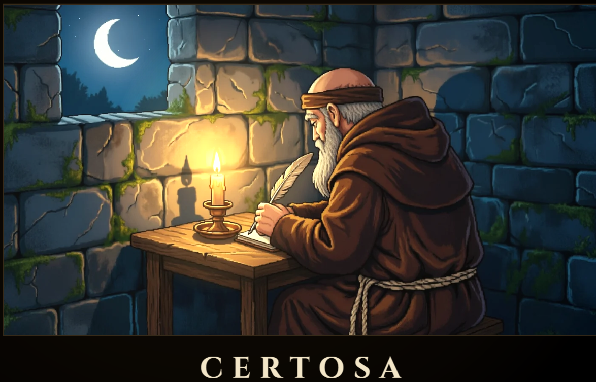

# Certosa MCP — paragrafi e archivio locale · 0.0.6-alpha.3

La versione alpha.3 corregge i casi individuati nel debug: rifiuta testo
Unicode non valido nelle modifiche ai paragrafi, permette di riaprire subito una
finestra locale annullata e chiude le richieste rimaste in attesa quando il
processo MCP viene sostituito. Separa inoltre le parole di paragrafi distinti nella
ricerca, aggiornando l'indice locale degli archivi incrementali esistenti senza
modificarne pagine, media, metadati o revisione dei contenuti. La verifica di
compatibilità controlla anche i tipi MIME e le sorgenti degli allegati accettati
dall'app. Il frontend 0.3.8 corretto conserva PDF e WAV durante il ripristino.
Conserva i 19 strumenti e il consenso di 30 minuti
di inattività introdotto in alpha.2.

Download ufficiali: [MCPB Windows](https://certosa.htnzlab.it/downloads/mcp/0.0.6-alpha.3/certosa-archives-0.0.6-alpha.3-windows.mcpb),
[ZIP portatile](https://certosa.htnzlab.it/downloads/mcp/0.0.6-alpha.3/certosa-archives-0.0.6-alpha.3-windows-portable.zip),
[sorgenti](https://certosa.htnzlab.it/downloads/mcp/0.0.6-alpha.3/certosa-mcp-0.0.6-alpha.3-source.zip) e
[SHA256SUMS](https://certosa.htnzlab.it/downloads/mcp/0.0.6-alpha.3/SHA256SUMS).
Verificare gli hash prima dell'uso e seguire [le istruzioni](INSTALL.it.md).
La pubblicazione dei file non installa il connettore nei client.

Questa versione aggiunge `read_page_blocks` e `prepare_paragraph_edit`: 19 strumenti
totali. Si leggono testo, stili, confini dei segmenti e hash di paragrafi selezionati;
le proposte modificano intervalli di testo e stili `normal`, `title`, `heading`,
`bullet`, `quote` senza riscrivere il markup circostante. Testo inserito eredita
lo stile del primo segmento interessato. Note, allegati e altre pagine restano
invariati; revisione, hash e testo atteso prevengono modifiche su una copia obsoleta.

Il vecchio `replace` rifiuta pagine con formattazione invece di appiattirle:
usare i nuovi strumenti per modifiche mirate. `append` resta disponibile.
Paragrafi annidati, tabelle e intervalli che rimuovono a capo `<br>` sono rifiutati
esplicitamente; nessun HTML arbitrario è accettato. I nuovi strumenti riguardano
gli archivi `.certosa` e `.certosa-db`; il laboratorio browser storico riceve
la protezione da sostituzioni distruttive ma non questi strumenti strutturati.

La nuova presentazione dei paragrafi richiede il frontend Certosa 0.3.8: la precedente
0.3.7 non interpreta questi stili e l'importazione precedente può rimuoverne
gli attributi. Il cambio stile è consentito soltanto su `div.p`, indicati da
`styleEditable: true`; testo mirato resta modificabile anche in `div`/`p` legacy.
La compatibilità verificata del contenitore cifrato non garantisce la resa visiva
o la conservazione dei nuovi attributi attraverso frontend precedenti.

Il connettore elabora e sblocca localmente. Gli estratti autorizzati vengono però
consegnati al client MCP, che può inoltrarli al provider della chat. Il connettore
non controlla rete o conservazione di quel client. Uso privato offline richiede
client e modello locali verificati. Revocare accesso non ritira dati già consegnati.

Le prove usano archivi sintetici e includono pacchetti estratti, SDK MCP e
compatibilità con Certosa 0.3.8. Non attestano l’installazione in uno specifico
client o la qualifica di dispositivi fisici. Correzioni e limiti sono in
`CHANGELOG.md`; le sezioni storiche conservano il contesto delle prove precedenti.

## Archivio e anteprima nell'app

Il file `.certosa` contiene la biblioteca strutturata, i metadati supportati e
i media referenziati. Non contiene l'eseguibile, i permessi del browser, tutte
le preferenze dell'interfaccia o i motori vocali installati. Il connettore conserva
anche i campi sconosciuti già presenti nel pacchetto. Importare ed esportare
trasferisce una copia dei dati; non sincronizza due applicazioni aperte.

Una prova locale con Certosa 0.3.8 e Chrome isolato ha automatizzato importazione,
ricerca, visualizzazione, modifica da tastiera/toolbar, salvataggio, riapertura
ed export cifrato. Venti controlli browser/lettore MCP hanno verificato il giro
completo, inclusi stili, note e immagini. La preview usa il renderer di Certosa.
Il collaudo usa dati sintetici e il normale download dell'app, con il selettore
nativo disabilitato all'avvio di Chrome. Non qualifica il selettore Windows
predefinito, un dispositivo fisico o l'inserimento di password personali.

Questo dimostra la fattibilità dell'automazione tramite browser, ma i 19 strumenti
MCP non includono ancora avvio browser, preview grafica o sincronizzazione live.
Per questa candidata non sono stati aggiunti nuovi strumenti per gli asset.
Il vecchio laboratorio live ha un limite distinto: una revoca non annulla un
salvataggio browser già avviato. La protezione prima del commit verificata sui
motori archivio non qualifica quel percorso; dettagli in `LIVE-LAB.md`.



## Connettore installabile: riconoscere, lavorare, validare e salvare

Storico — versione 0.0.5-alpha.1: pacchetto Claude Desktop `.mcpb`, ZIP portatile con
dipendenze e configurazioni per ChatGPT/Codex e host MCP locali, skill inclusa.
Vedi [installazione completa](INSTALL.it.md). Le istruzioni MCP insegnano al
modello a riconoscere `.certosa` e chiedere lo sblocco nella finestra locale.
Non cambiano i pesi del modello o le associazioni file di Windows.

Nuovi strumenti: `get_archive_capabilities`, `prepare_archive_edit`,
`validate_archive`. Un batch atomico può creare quaderni, scrivere molte pagine,
modificare autore/font o aumentare capienza, fino100operazioni/200.000nuovi
caratteri. La creazione richiede una scelta locale separata. La versione precedente esponeva 17 strumenti
totali, con prompt e risorsa `certosa://archive-workflow`.

L'export finale è un vero `.certosa` CRTS2: verifica struttura, allegati e piano
di importazione originale, poi rilegge il temporaneo cifrato con Zip/Copia di
Certosa e confronta tutti i valori serializzati prima di pubblicarlo. Il
risultato deve avere `nativeReaderVerified`, `nativeImportPlanVerified` e
`allValuesPreserved` a true. Nessuna sovrascrittura di destinazioni esistenti.
La compatibilità verificata riguarda le funzioni correnti incluse; renderer
mobile e versioni future richiedono prove proprie.

Test di regressione:81pass, inclusi creazione/modifica atomica su entrambi i
backend, rollback completo, conflitti, media mancanti, volumi incompatibili,
export concorrente, SDK reale e avvio da configurazioni desktop generate.
La prova owner precedente ha già verificato sblocco/import/backup nativi, ma
questi nuovi pacchetti non risultano ancora installati nei suoi account Claude
o ChatGPT. Nessuna submission ai cataloghi.


Il motore legge, cerca e modifica archivi senza aprire Certosa o il browser.
Aggiunge soltanto **autore**, disponibile in lettura, ricerca e modifica con
anteprima. Non introduce campi edizione o illustratore; conserva eventuali
metadati già presenti.

## Due formati, nessuna migrazione automatica

- `.certosa`: formato attuale CRTS2, letto e scritto come prima. Compatibilità
  verificata anche con le funzioni originali di Certosa.
- `.certosa-db`: nuovo archivio di lavoro cifrato, con pagine compresse
  separatamente, indice di ricerca, cronologia e media deduplicati in blocchi
  da 3 MiB. Una modifica aggiorna soltanto i record interessati.

`import_archive` richiede scelta e password locali, crea una **copia separata**
incrementale e conserva l'originale. `export_archive` crea una copia `.certosa`
compatibile quando rientra nei limiti del formato corrente: 256 MiB di file,
512 MiB di JSON espanso, 10.000 pagine per quaderno, 100.000 elementi pagina.
Un export troppo grande viene rifiutato interamente, senza tagliare contenuti.
`backup_archive` salva invece una copia completa `.certosa-db`, cifrata con la
stessa password, verificata anche oltre 1 GiB. Le destinazioni esistenti non
vengono sovrascritte. L'app Certosa attuale non apre direttamente `.certosa-db`.

## Avvio

Node.js 22.13+; flusso locale attualmente supportato su Windows PowerShell con
Windows Forms. Verificato su Windows x64, Node 22.23.4. La dipendenza SQLite
nativa include i precompilati: non occorre abilitarne gli script di installazione
su questa piattaforma. Altri sistemi e telefoni non sono qualificati.
Impostare TEMP/TMP/TMPDIR e cache npm/Node nella cartella del progetto.

```sh
npm ci --ignore-scripts
node src/archive-setup.mjs --project /percorso/progetto --out /percorso/progetto/certosa-archives
```

Nel checkout privato eseguire l'installazione in `connector` e usare
`connector/archive-setup.mjs`. Il setup conserva i runtime esistenti e prepara
esempi Codex TOML e Claude JSON. Configurare il client MCP stdio con
`node <repo>/src/archive-mcp-server.mjs <runtime>/archive-engine.json`.
Chiedere alla chat di aprire o importare un archivio. Scelta file, password e
selezione quaderni avvengono nella finestra Windows, mai nei parametri MCP.

Il consenso può essere di sola lettura e scade dopo 30 minuti di inattività.
Ogni operazione autorizzata riuscita rinnova l’attesa; stato, capabilities e
handshake non la rinnovano. Un’operazione già in corso può terminare, ma una
revoca esplicita blocca comunque il salvataggio. Un errore non rinnova il consenso.
Dopo scadenza o revoca occorrono nuovo sblocco e consenso locali. I file incrementali
devono essere nel progetto configurato. I vecchi `.certosa` scelti fuori dal
progetto sono lavorati in una copia cifrata locale dichiarata nella finestra.
Manuale, cestino, quaderni `sensitivity: secret` o con `localCredential` sono
esclusi dagli strumenti generici. Il titolo Passwords da solo non classifica:
escludere localmente eventuali quaderni di credenziali non classificati.
Questa versione non usa credenziali personali. Gli estratti autorizzati
richiesti sono leggibili dalla chat e dal suo provider.

## Diciannove strumenti correnti

- `open_archive`, `import_archive`, `get_archive_status`, `close_archive`.
- `list_notebooks`, `read_notebook`, `search_notebooks`, `count_word`.
- `prepare_edit`, `prepare_author_edit`, `read_proposal`, `apply_proposal`.
- `export_archive`, `backup_archive`.
- `get_archive_capabilities`, `prepare_archive_edit`, `validate_archive`.
- `read_page_blocks`, `prepare_paragraph_edit`.

`count_word` conta esattamente nelle pagine e note autorizzate, escludendo
titoli e cestino. Le posizioni restituite sono limitate, il totale no.
L'HTML è letto come dati. I nuovi strumenti modificano testo nei segmenti esistenti
conservando il markup; il contenuto fornito dal modello è sempre testo letterale.
Prima della scrittura si prepara e rilegge una proposta legata alla revisione.
Non ripetere automaticamente una scrittura dopo esito incerto: rileggere prima.

## Cifratura, salvataggio e recupero

Il nuovo backend usa SQLite3 Multiple Ciphers, profilo SQLCipher non legacy:
AES-256-CBC con HMAC-SHA512, PBKDF2-SHA512 a 600.000 iterazioni, intestazione
cifrata. Anche indice, cronologia, allegati e journal WAL sono cifrati;
temporanei SQL in memoria, nessun fallback SQLite in chiaro.
Il formato `.certosa` conserva PBKDF2-SHA256 e gzip prima di AES-256-GCM.
Password e chiavi restano nel processo locale di esecuzione, separato dal
servizio che risponde alla chat. Se questo processo cade, servono nuovo
sblocco e consenso; nessuna ripetizione automatica delle scritture.

Le transazioni controllano la revisione e conservano il valore precedente
del record modificato nella cronologia cifrata. Il ripristino è disponibile
nell'API locale del motore, provato su copia isolata; non è esposto come
strumento MCP in questa release. Anche il ripristino crea un punto di recupero.
Importazioni interrotte non diventano archivi completi pubblicati.
Nessuna cancellazione o pulizia automatica di cronologia e media.

Un `.certosa-db` aperto può avere file `-wal` e `-shm`: non copiare il solo file
principale mentre è in uso. Usare `backup_archive` per una copia consistente.
Gli originali multimediali restano identici; si comprime soltanto quando
conviene, senza ricodifica con perdita. SQLite può occupare più spazio del
vecchio formato: il vantaggio misurato è il salvataggio incrementale.

## Prove e limiti

66 test di dominio/motore, più verifiche SDK del vecchio percorso (23), nuovo
percorso incrementale (19) e avvio/riavvio servizio (5). Include password
errata, manomissione, cifratura WAL/FTS, permessi, conflitti, interruzione
di transazione/importazione, recupero e interoperabilità con il formato attuale.

Benchmark sintetico su questo PC e disco H: 10 quaderni, 40.000 pagine e
1 GiB di media pseudocasuali realmente scritti e riletti con checksum.
Modificare una pagina e l'autore produce 86.552 byte di WAL, senza riscrivere
i media; il run ottimizzato ha un picco di memoria di circa 237 MiB.
I tempi dipendono da macchina e disco; non è una prova su Realme/mobile.
Il benchmark pesante è separato: `node --expose-gc tests/benchmark_large_archive.mjs`;
aggiungere `CERTOSA_BENCHMARK_SNAPSHOT=1` per la copia cifrata completa.

```sh
npm test
```

Il flusso Windows di scelta/password/consenso sul formato precedente è stato
verificato anche dall'owner; i nuovi flussi import/backup sono coperti con UI
iniettata nei test, senza dichiararli già accettati dall'owner. Nessuna prova
di perdita elettrica, account provider, ponte remoto o submission ai cataloghi.
Il pacchetto non contiene archivi, profili, runtime, password o log di contenuti.
Il precedente laboratorio è descritto in LIVE-LAB.md; stato distribuzione e
submission in DISTRIBUTION.md. Licenza MIT del codice e licenze dei componenti
nelle dipendenze installate.
